
<a href="README.md">简体中文</a> · <strong>English</strong>

<h1>
  <picture>
    <source media="(max-width: 600px) and (prefers-color-scheme: dark)" srcset="assets/brand/hero-en-dark-mobile.webp">
    <source media="(max-width: 600px)" srcset="assets/brand/hero-en-light-mobile.webp">
    <source media="(prefers-color-scheme: dark)" srcset="assets/brand/hero-en-dark.webp">
    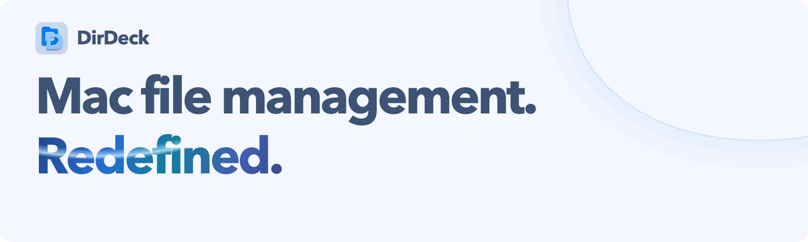
  </picture>
</h1>

<strong>Browse like a browser. Work like a Swiss Army knife.</strong>

DirDeck is an all-in-one file workspace for Mac. Find files, preview content, edit images, split PDFs and organize your desktop, right where your files are.

  <a href="https://apps.apple.com/cn/app/dirdeck/id6794571378?mt=12"><strong>View on the Mac App Store</strong></a> ·
  <a href="https://dirdeck.com/en/">Explore the website</a> ·
  <a href="https://github.com/fuxiaoai/dirdeck-community/issues/new/choose">Feedback & ideas</a>

macOS 15 or later · 7-day full-feature trial · No DirDeck account required

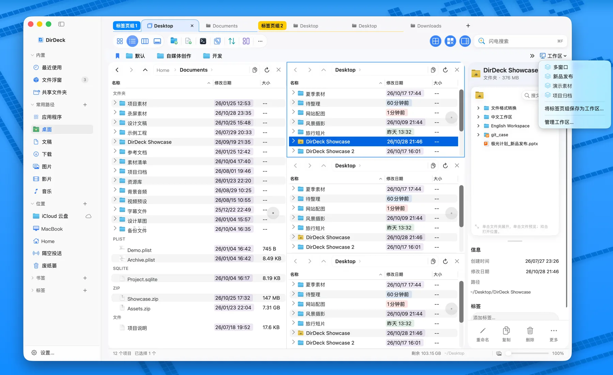

## Perhaps the most powerful file manager you've ever used

Tabs and split panes keep several folders in view. Super Preview shows what's inside. Image, PDF, archive and renaming tools put the next step beside the file. Spend less time switching apps and more time finishing the task at hand.

[Browse & organize](#browse) · [Super Preview](#preview) · [Archives](#archives) · [Lightning Search](#search) · [File tools](#tools) · [Desktop](#desktop) · [Within reach](#floating)

Real product screenshots below show the Chinese interface. Features depend on your installed version; see the App Store and changelog for public release information.

## More folders. Less juggling.

Keep references, work in progress and delivery folders in separate tabs. Group tabs by project and give each group a color. Drag frequently used files and folders into favorites, then organize them into nested groups by client or task.

**Need to compare? Put them side by side.** Choose from 12 layouts with 1–4 panes. Each pane keeps its own browsing position, and files can be dragged between them. Save folders, tabs and layouts as a workspace to pick up later. Let it remember changes automatically, or update it only when you save.

See tab groups and nested favorites

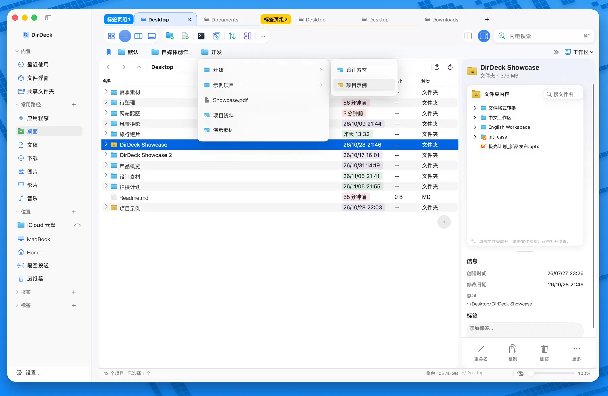

## See what's inside. Then act on it.

Select a file and press **Space**. Preview 100+ formats, including images, PDFs, Office files, Markdown, audio and video. Explore folders and nested archives layer by layer. Once you've found the file, copy, rename, send or drag it out from the preview.

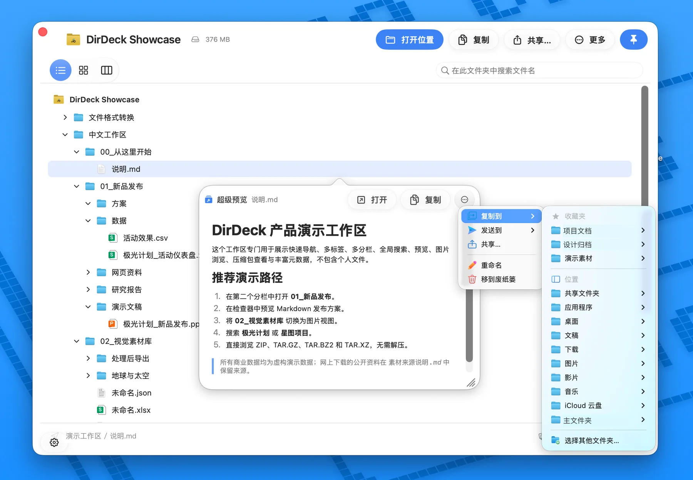

Preview capabilities vary by format. Some formats depend on macOS and installed preview extensions.

## Work inside archives like folders

Received a whole archive but only need one photo? Browse inside and drag it out, without extracting everything. Drag ordinary files into writable archives, too. Rename files, organize folders or edit supported text files, then write the changes back to the archive.

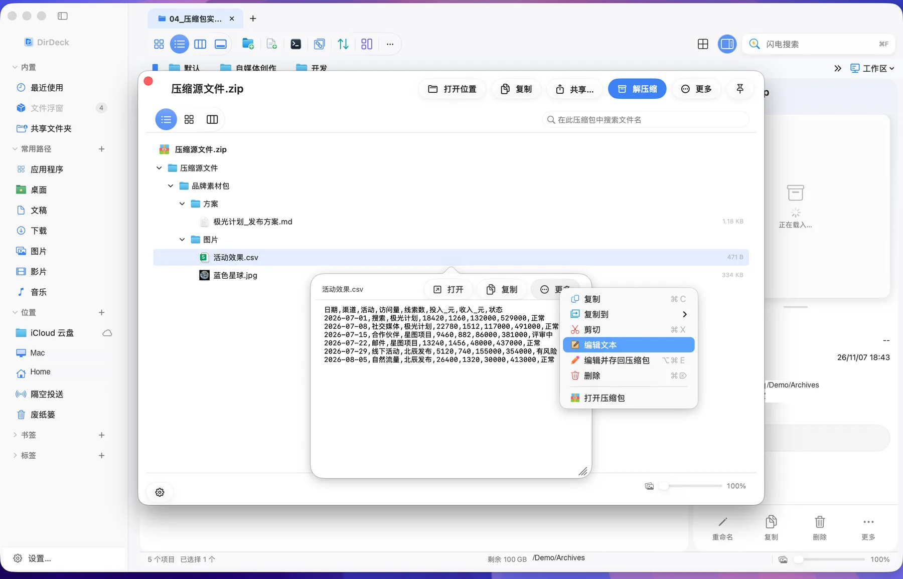

Create ZIP, 7Z or TAR archives, and read or extract RAR. Export just the selected items as a new archive. **Writing, encryption and split volumes depend on the format and file state.** Read-only formats can still be browsed and extracted.

## A little clue is enough to start

Lightning Search finds files by name, path and filters, with support for common Everything search syntax. Preview, copy, move or open a result directly, without navigating back to its folder.

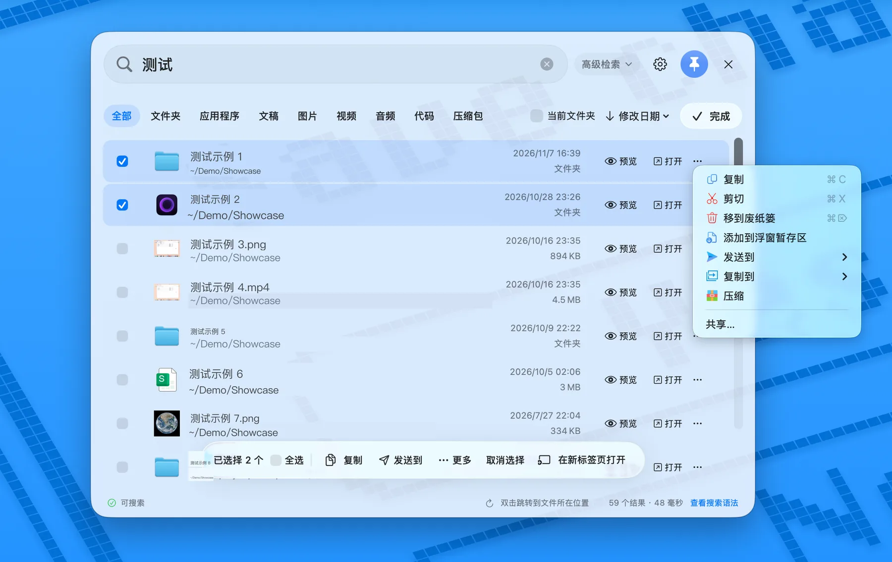

Authorize the locations you want to search and build the index first. Add an external drive from its device menu and keep it connected while searching. Content search returns results progressively; access permissions determine the search scope. [Read about search and permissions →](https://dirdeck.com/en/support/)

## Small jobs, done with a right-click

Need to submit a PDF but only have photos? Select them and create one from the menu. Oversized attachments, the wrong pages or inconsistent filenames can all be handled beside the files.

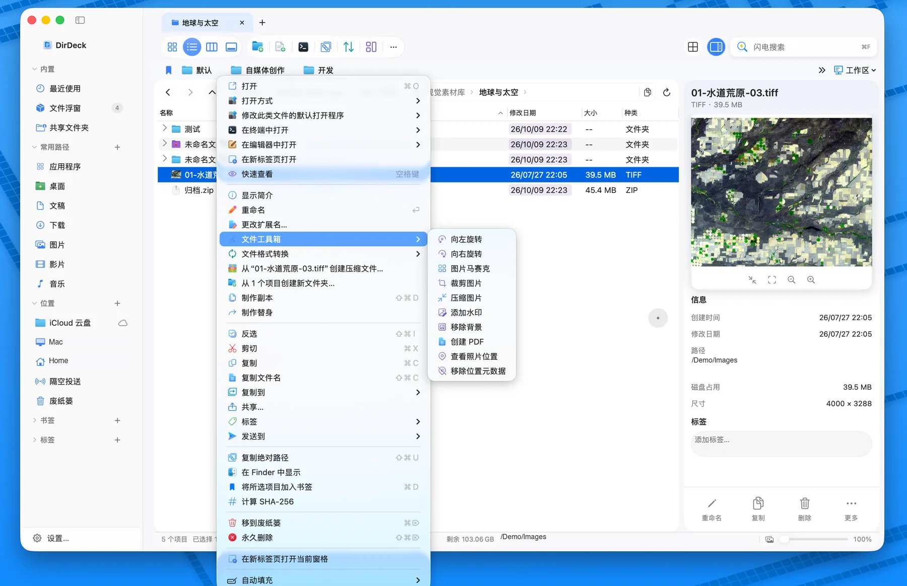

| Your task | Do it in DirDeck |
| --- | --- |
| Prepare a batch of images | Crop, rotate, watermark, remove backgrounds, resize, compress and convert |
| Deliver a few PDF pages | Merge, split, extract, rotate, compress or export as images |
| Make filenames consistent | Combine replacement, prefix, suffix and numbering rules; preview before applying |
| Change a file's format | Convert images, documents, PDFs, audio and video; available formats depend on the file and macOS support |
| Start from familiar content | Create files from templates, or paste clipboard text and images as files |

See PDF extraction and batch renaming

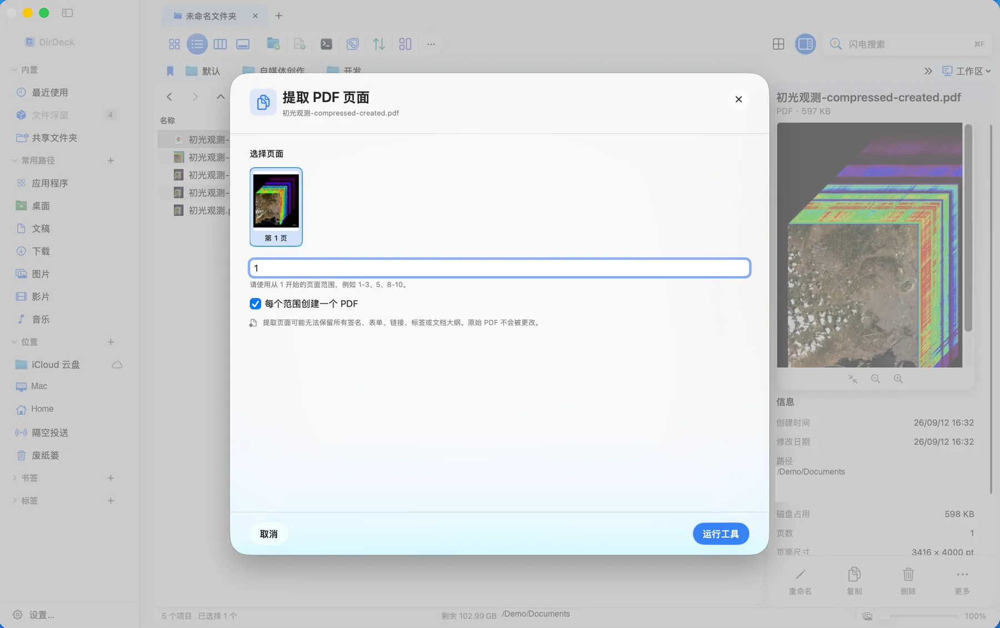

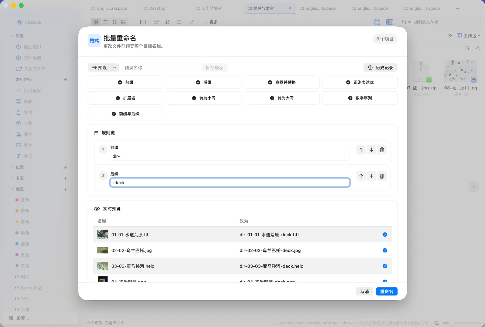

## A desktop with room to work

Group screenshots, documents and images automatically, or create dedicated areas for your projects. After granting access and enabling desktop management, search, preview and drag files right on the desktop. Grouping itself leaves files in place; move selected files into a new folder when you want to.

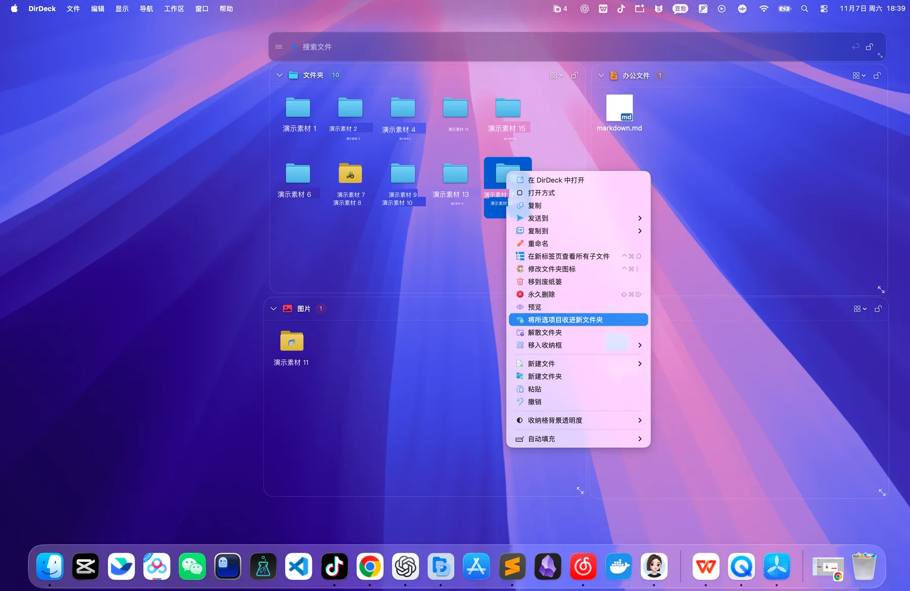

## The files you need, within reach

While DirDeck is running, move the pointer to your configured screen edge to reveal the **Floating Window**. Pin downloads, assets and projects as tabs. Search, press Space to preview, then drag a file into the app you're working in.

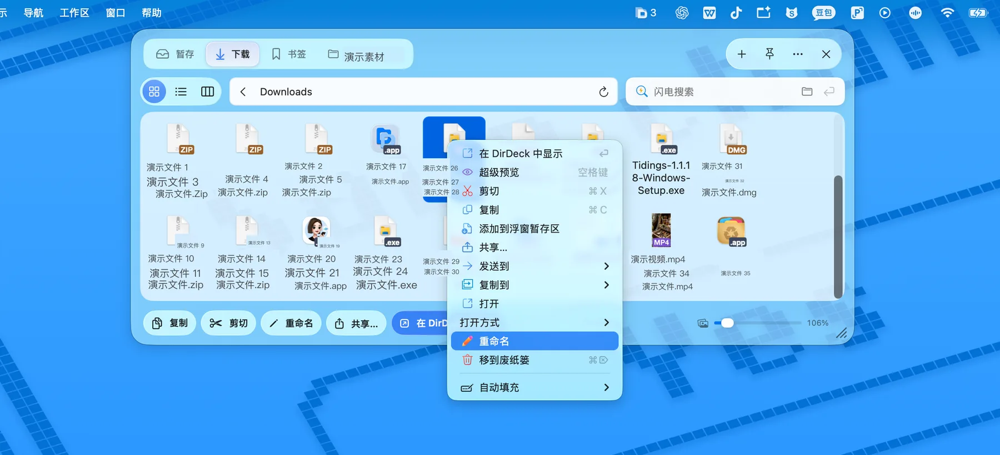

Collect files across windows in **File Transit**, then drag a group out when you reach its destination. The **Floating Orb** brings actions such as back, forward, compression and gathering files near your pointer. Choose and order the actions to suit your habits.

### Keep your familiar Mac habits

Import Finder favorites and keep using existing tags. Customize context menus, folder icons, terminals and editors. Connect to SMB, AFP, NFS, WebDAV and read-only FTP through macOS-supported methods; writing depends on the protocol and server permissions.

## Start with your next file

**[View on the Mac App Store →](https://apps.apple.com/cn/app/dirdeck/id6794571378?mt=12)**

Requires macOS 15 or later. Try all features free for 7 days; the trial itself does not charge you automatically. Afterward, choose annual or lifetime access. Annual access renews automatically; prices and purchase terms are shown in the App Store and purchase screen.

[Website](https://dirdeck.com/en/) · [Changelog](https://dirdeck.com/en/changelog/) · [Support](https://dirdeck.com/en/support/) · [Privacy](https://dirdeck.com/en/privacy/) · [Terms](https://dirdeck.com/en/terms/)

## Help make everyday file work better

This is DirDeck's official product community and feedback repository. **It does not contain the application's source code.** Feedback in English or Chinese is welcome.

- **Something went wrong:** [Report a bug](https://github.com/fuxiaoai/dirdeck-community/issues/new?template=bug_report.yml). Include your app and macOS versions, steps to reproduce, and expected and actual results.
- **Have an idea:** [Suggest a feature](https://github.com/fuxiaoai/dirdeck-community/issues/new?template=feature_request.yml). Tell us what you want to accomplish and what gets in the way.
- **Follow progress:** [Browse existing issues](https://github.com/fuxiaoai/dirdeck-community/issues) and add details about similar experiences.

Issues are public. Hide private filenames, paths and account information before uploading anything. For purchases, orders or matters that need a private conversation, email [fxapps@163.com](mailto:fxapps@163.com). [Read the contribution guide →](CONTRIBUTING.md#english)
