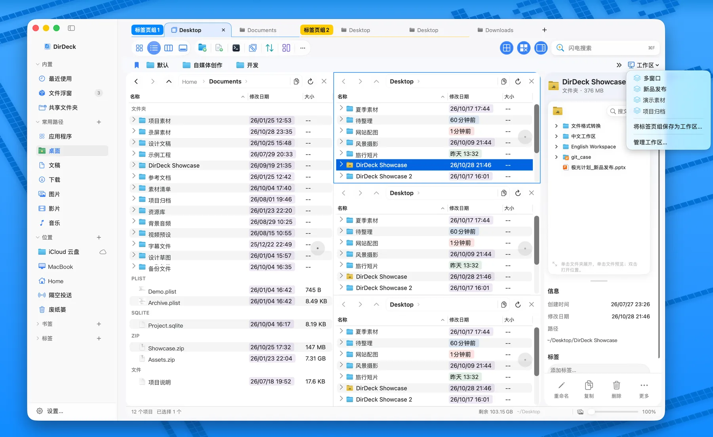
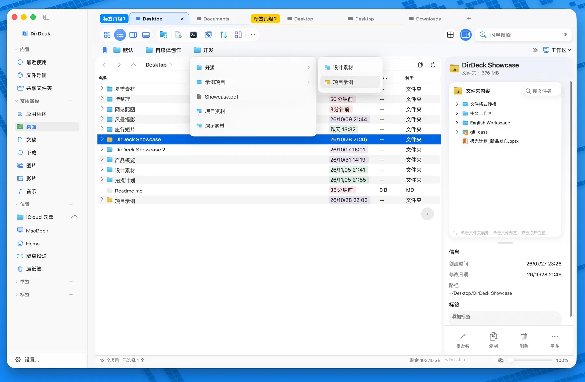
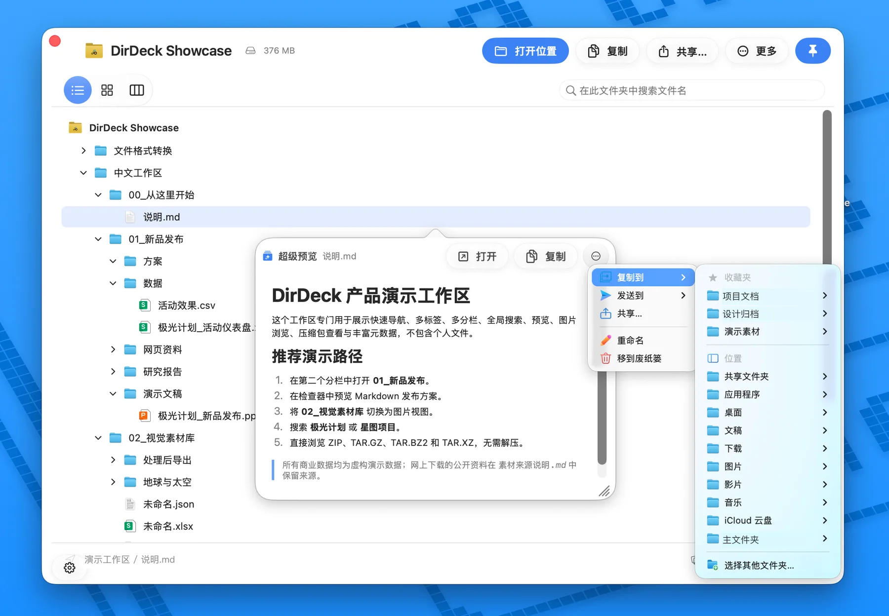
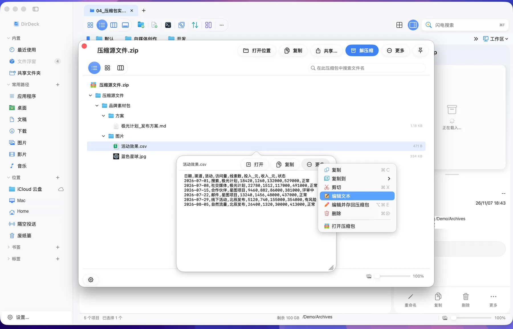
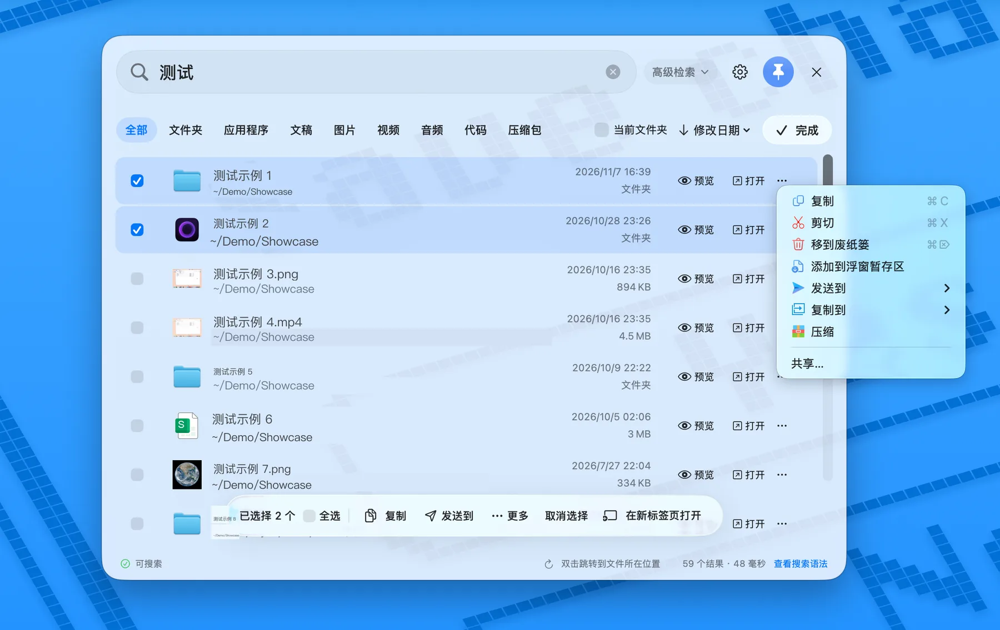
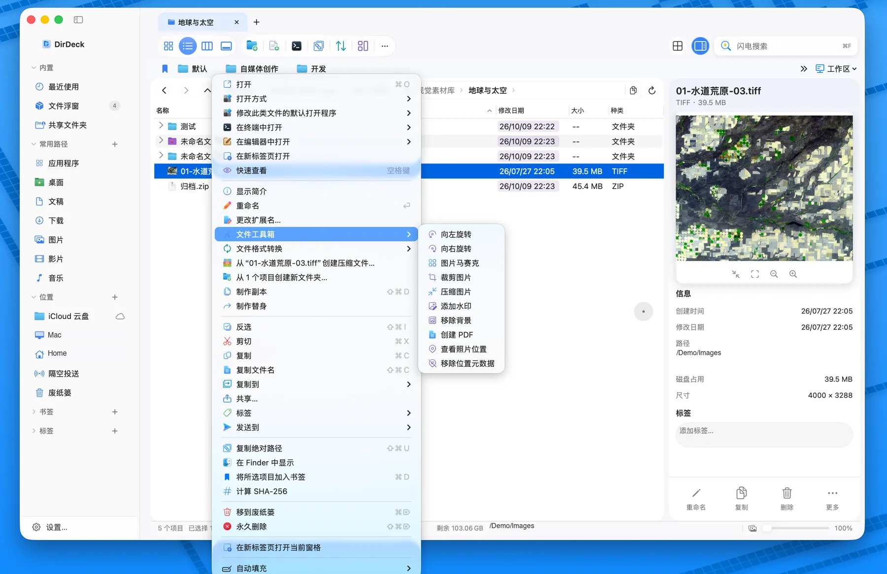
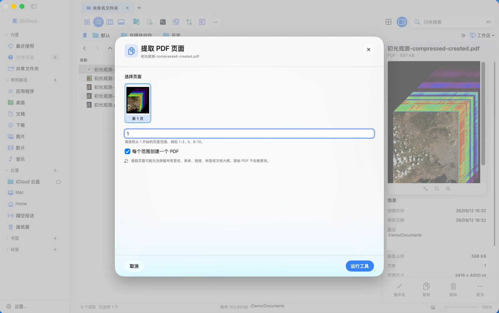
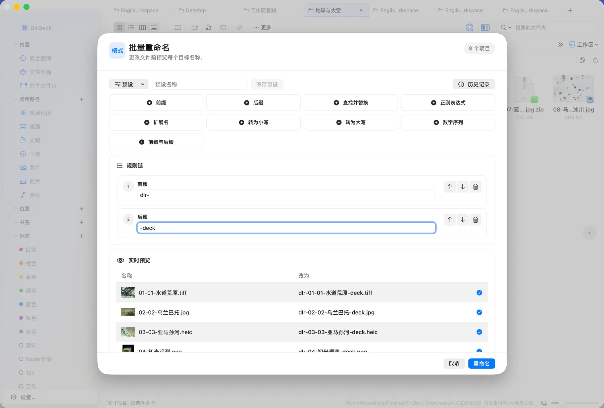
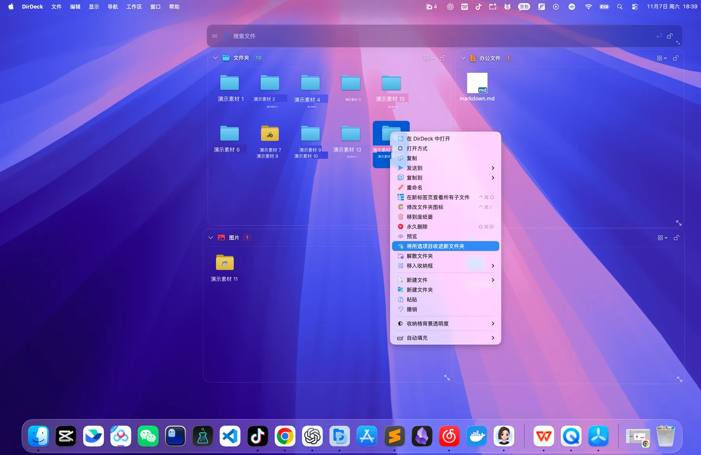
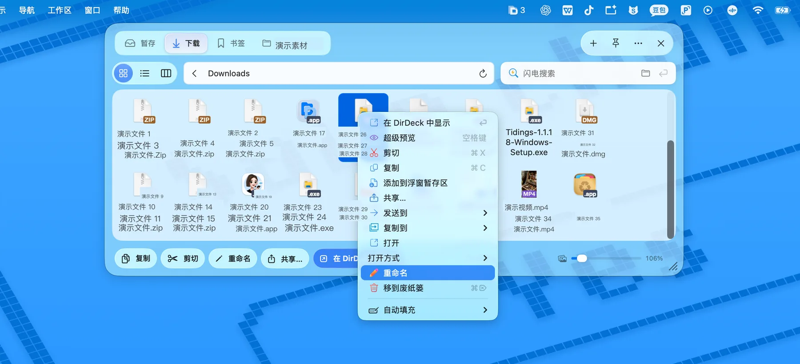

#  重新定义 Mac 文件管理 简体中文 · [English](README.en.md)

<strong>像浏览器一样管理，像瑞士军刀一样处理。</strong>

DirDeck 是 Mac 上的一站式文件工作台。 从找文件、看内容，到改图片、拆 PDF、整理桌面，在文件旁边完成。

  <a href="https://apps.apple.com/cn/app/dirdeck/id6794571378?mt=12"><strong>前往 Mac App Store</strong></a> ·
  <a href="https://dirdeck.com/">探索官网</a> ·
  <a href="https://github.com/fuxiaoai/dirdeck-community/issues/new/choose">反馈与建议</a>

macOS 15 及以上 · 7 天全功能试用 · 无需注册 DirDeck 账号

## 也许是你用过的最强大的文件管理软件

标签页与分屏让多个目录同时可见；超级预览让你先看清内容；图片、PDF、压缩包与重命名工具，让下一步操作就在手边。少在几个应用间切换，把眼前这份工作做完。

[浏览与组织](#browse) · [超级预览](#preview) · [压缩包](#archives) · [闪电搜索](#search) · [文件工具](#tools) · [桌面整理](#desktop) · [随手取用](#floating)

下方为真实产品截图；展示功能以所安装版本为准，公开版本信息请查看 App Store 与更新日志。

## 打开再多，也有条理

把参考资料、正在修改的文件和交付目录放进不同标签页，按项目分组、用颜色区分。常用文件和文件夹拖进收藏栏，再按客户或用途建立多层分组。

**要对照，就并排放。** 12 种分屏布局、1–4 个窗格，每栏保留自己的浏览位置，文件可以跨栏拖放。把目录、标签页和布局存成工作区，下次接着用；自动记住调整，或只在手动保存时更新，由你决定。

## 不用打开，就能看到；看到，就能操作

选中文件，按下 **空格**。图片、PDF、Office、Markdown、音视频，100+ 种格式可以预览；文件夹和嵌套压缩包还能逐层展开。看准需要的文件，直接复制、重命名、发送或拖出。

不同格式的预览能力有所不同，部分格式依赖 macOS 与已安装的预览扩展。

## 压缩包，像文件夹一样管理

收到一整包素材，只要其中一张照片？点进去看，找到就拖出来，不必先解压整包。普通文件也能拖进可写压缩包；包内改名、整理目录或编辑支持的文本后，修改可以直接写回。

创建 ZIP、7Z 或 TAR，读取与提取 RAR；只需要一部分内容，也能选中后另存为新压缩包。**写入、加密与分卷能力取决于格式和文件状态**，只读格式仍可浏览和提取。

## 记得一点线索，就能开始找

闪电搜索按文件名、路径和筛选条件查找文件，也支持常用的 Everything 搜索语法。搜到后直接预览、复制、移动或打开，不用先跳回原目录。

先授权需要搜索的位置并建立索引。外接盘可在设备菜单中加入搜索，查询时保持连接；正文内容搜索逐步返回结果。搜索范围取决于访问授权。[查看搜索与权限说明 →](https://dirdeck.com/support/)

## 右键一下，小事当场办好

报名要交 PDF，手里只有几张照片？选中照片，右键就能合成一份。附件太大、页码不对、文件名太乱，也从文件旁边开始处理。

| 手头的事 | 在 DirDeck 里完成 |
| --- | --- |
| 准备一批图片 | 裁切、旋转、水印、移除背景、调整尺寸、压缩和转换格式 |
| 交付几页 PDF | 合并、拆分、提取、旋转、压缩或导出图片 |
| 统一文件名 | 组合替换、前后缀与编号规则，先预览再应用 |
| 换一种文件格式 | 图片、文稿、PDF 与音视频转换，可用格式随文件和 macOS 支持而异 |
| 从常用内容开始 | 新建文件模板，或把剪贴板里的文字、图片直接粘贴成文件 |

| PDF 页面提取 | 批量重命名 |
| --- | --- |
|  |  |

## 桌面有秩序，文件有位置

截图、文档、图片自动归类，也能给手头的项目划出专门收纳区。授权并开启桌面托管后，直接在桌面搜索、预览和拖放；分组本身不会改变文件位置，需要时再把选中文件收入新文件夹。

## 需要的文件，总在手边

DirDeck 运行时，把鼠标移到设好的屏幕边缘，**文件浮窗**就会出现。把下载、素材和项目固定成标签，搜索、空格预览，挑中后直接拖进正在使用的应用。

跨窗口收集文件，用**文件中转舱**成组暂存，到目的地再一起拖出。窗格里的**悬浮球**则把前进、后退、压缩或收纳等常用动作放到鼠标附近，按习惯选择和排序。

### 熟悉的 Mac 用法，接着用

导入 Finder 收藏，继续使用已有标签；按需配置右键菜单、文件夹图标、终端和编辑器。通过 macOS 支持的方式连接 SMB、AFP、NFS、WebDAV 与只读 FTP，写入能力取决于协议与服务器权限。

## 从下一份文件开始

**[前往 Mac App Store →](https://apps.apple.com/cn/app/dirdeck/id6794571378?mt=12)**

macOS 15 及以上。首次使用可体验 7 天全部功能，试用本身不自动扣费。到期后可选择年度或终身使用权；年度使用权自动续费，价格与购买条件以 App Store 和购买页面为准。

[官网](https://dirdeck.com/) · [更新日志](https://dirdeck.com/changelog/) · [使用支持](https://dirdeck.com/support/) · [隐私政策](https://dirdeck.com/privacy/) · [使用条款](https://dirdeck.com/terms/)

## 一起把日常文件工作变顺手

这里是 DirDeck 的官方产品社区与反馈仓库，**不包含应用源代码**。欢迎用中文或英文交流使用问题与功能建议。

- **遇到问题：** [提交问题反馈](https://github.com/fuxiaoai/dirdeck-community/issues/new?template=bug_report.yml)，附上应用与 macOS 版本、复现步骤、预期和实际结果。
- **有个想法：** [提出功能建议](https://github.com/fuxiaoai/dirdeck-community/issues/new?template=feature_request.yml)，说说要完成什么，以及哪里不顺手。
- **想跟进进展：** [浏览已有 Issues](https://github.com/fuxiaoai/dirdeck-community/issues)，也可以补充相同场景。

Issues 公开可见，上传前请隐藏私人文件名、路径与账号信息。购买、订单或需要私下沟通的事项，请联系 [fxapps@163.com](mailto:fxapps@163.com)。[阅读反馈指南 →](CONTRIBUTING.md)
